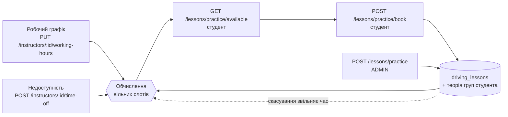

# Практика: як працює розклад, бронювання і хто що робить

Огляд усієї практичної частини після переходу на обчислені слоти: які є ендпоінти й навіщо, як сервер рахує вільний
час, сценарії ADMIN, INSTRUCTOR і STUDENT, прийняті рішення і що лишилося відкритим.

Стан: PR 1 (графік і недоступність) — у `develop`; PR 2 (обчислені слоти, бронювання, список для ADMIN) — цей PR;
PR 3 — видалення `practice_slots`.

---

## 1. Коротко

- **Заняття** (`DrivingLesson`) — єдиний запис, що «студент X їздить з інструктором Y о 09:00 20 листопада».
- **Графік і недоступність** — правила інструктора: коли він працює і коли ні. Самі по собі занять не створюють.
- **Слот** — вільні 120 хвилин, які сервер **рахує** з правил мінус уже зайняте. Слоти не зберігаються.
- Студент бронює слот, і з цього з'являється заняття. ADMIN може створити заняття напряму, в обхід графіка.
- Усі дороги ведуть в одну таблицю `driving_lessons` з тими самими перевірками конфліктів, тож розійтися нема чому.

---

## 2. Контролери — різні ресурси

Усі живуть в одному модулі `LessonsModule` і ділять ті самі хелпери: `schedule-conflicts.ts`, `practice-rules.ts`,
`schedule-lock.ts`, `availability.ts`. Контролер — це лише група URL навколо одного ресурсу.

| Контролер | URL | Ресурс | Хто |
|---|---|---|---|
| `LessonsController` | `/lessons/...` | **конкретне заняття**, теорія і практика: створення, зміна, перенесення, скасування, відвідування, `/lessons/me` | ADMIN, INSTRUCTOR, TEACHER, STUDENT — за ендпоінтом |
| `PracticeLessonsController` | `/lessons/practice` (GET), `/lessons/practice/available`, `/lessons/practice/book` | **практика: список для ADMIN, вільний час і бронювання для студента** | ADMIN — список; STUDENT — слоти й бронювання |
| `InstructorScheduleController` | `/instructors/:id/working-hours`, `/instructors/:id/time-off` | **правила інструктора** | ADMIN керує, INSTRUCTOR читає свої |
| `PracticeSlotsController` | `/practice-slots[/:id]` | слоти, створені вручну | **застаріло**, видаляється в PR 3 |

`PracticeLessonsController` і `LessonsController` мають спільний префікс `/lessons/practice`. Усе про практичні
заняття живе під однією адресою, а код — у двох класах: зміна заняття спільна з теорією, а бронювання й список — ні.

### Чому не один контролер

1. **Різні ресурси.** Заняття — факт з історією (статус, хто скасував, відвідування в теорії). Графік — налаштування
   інструктора, без студента. Вільний слот — обчислення, якого немає в БД. Коли URL називає ресурс, з адреси видно, що
   змінюється: `PUT /instructors/:id/working-hours` міняє правило інструктора, `PATCH /lessons/practice/:id/reschedule`
   — одне заняття.
2. **Різні ролі.** Графік — ADMIN, бронювання — STUDENT, зміна занять — ADMIN (інструктор лише місце зустрічі).
3. **Заняття спільні з теорією.** `LessonsController` обслуговує і теорію, і практику. Графік інструктора до теорії
   стосунку не має.
4. **Розмір.** `lessons.service.ts` уже ~930 рядків. Графік і бронювання в окремих сервісах легше читати й тестувати.

---

## 3. `PATCH /lessons/practice/:id/reschedule` проти `PUT /instructors/:id/working-hours`

| | Перенесення заняття | Робочий графік |
|---|---|---|
| Що змінює | **одне** заняття, одну дату | **правило на кожен тиждень** |
| Приклад | «урок Ірини 20.11 о 09:00 → 21.11 о 14:00» | «Олег працює пн–пт 09:00–13:00 і 14:00–18:00» |
| Що в БД | оновлюється `scheduled_at` одного рядка `driving_lessons` | замінюються рядки `instructor_working_hours` |
| Вплив на заняття | рухає саме це заняття | **жодне заняття не рухає**; змінює лише, які слоти побачать студенти далі |
| Хто | ADMIN | ADMIN |
| Перевіряє | конфлікти інструктора, авто, студента, теорію студента, недоступність | формат, перетин інтервалів, інструктор ACTIVE |

Аналогія: графік — години роботи перукарні на дверях; перенесення — пересунути запис одного клієнта.

---

## 4. Як сервер рахує вільні слоти

Для студента береться його інструктор і його авто (`Student.instructorId`, `Student.carId`). Для кожного місцевого дня
вікна `[from, to)` у часовому поясі автошколи
([availability.ts](../src/modules/lessons/availability.ts)):

1. Інтервали робочого графіка цього дня тижня.
2. Нарізка кожного інтервалу на старти з кроком **120 хвилин** від початку інтервалу, поки заняття вміщується до кінця
   інтервалу (`09:00–13:00` → 09:00 і 11:00; `09:00–12:30` → лише 09:00).
3. Старт → момент UTC. Місцевого часу, якого немає (перехід на літній час), пропускається.
4. Відкидається старт, що:
   - уже минув або виходить за `[from, to)`;
   - перетинає недоступність інструктора;
   - перетинає SCHEDULED-практику інструктора, авто чи самого студента, або SCHEDULED-теорію груп студента.

Інструктор не ACTIVE чи авто не AVAILABLE, не закріплене за інструктором або не підходить студенту — список порожній.

### Приклад

Олег, понеділок 23.11: графік `09:00–13:00` і `14:00–18:00`; недоступність `16:00–18:00` (лікар); ADMIN поставив
іншому студенту урок `10:00–11:00`; в Ірини теорія групи `12:00–13:30`.

| Старт (120 хв) | 09:00 | 11:00 | 14:00 | 16:00 |
|---|---|---|---|---|
| Ірина бачить | ❌ урок 10:00 | ❌ теорія 12:00 | ✅ | ❌ лікар |

---

## 5. Що перевіряє сервер при кожній дії

| Перевірка | Бронювання студентом | Створення / перенесення ADMIN | Нова недоступність | Новий графік |
|---|---|---|---|---|
| Робочий графік | так: час має бути одним зі стартів сітки (`409`) | **ні** — так ADMIN додає разову зміну | — | — |
| Недоступність інструктора | так | так (`lessonType: TIME_OFF`) | — | — |
| Заняття інструктора / авто / студента | так | так | SCHEDULED-практика інструктора → `409` | — |
| Теорія груп студента | так | так | — | — |
| Одне незакінчене заняття студента | так (`409`) | **ні** | — | — |
| Студент PRACTICE, профіль повний | так (+ авто в профілі) | так | — | — |
| Інструктор ACTIVE, авто AVAILABLE і підходить | так | так | інструктор ACTIVE | інструктор ACTIVE |
| Advisory-ключі | `instructor:`, `car:`, `student:`, групи | ті самі | `instructor:` | `instructor:` |

Спільний ключ `instructor:` серіалізує всі чотири дії, ключ `student:` — бронювання одного студента. Тому два студенти,
що одночасно бронюють ту саму годину, отримають `201` і `409`, а не два заняття. Студент, що відправив два бронювання
паралельно, отримає одне заняття. Недоступність і заняття не запишуться обидва. Усе це покрито інтеграційними тестами.

---

## 6. Сценарії

### ADMIN

**Підготовка (один раз):**
1. Запросити інструктора → він приймає запрошення → `ACTIVE`.
2. Створити авто й закріпити за інструктором: `POST /cars`, `PATCH /cars/:id/instructor`.
3. Задати графік: `PUT /instructors/:id/working-hours` з усім тижнем.
4. Після теорії видати студенту допуск: `PATCH /students/:id/practice-access` з інструктором і авто → `PRACTICE`.
   З цієї миті студент бачить вільні слоти свого інструктора.

**Щодня:**
- **Бачити розклад практики:** `GET /lessons/practice?from&to&instructorId&studentId&includeCancelled`.
- **Студент дзвонить, а не бронює сам** / **разова додаткова зміна:** `POST /lessons/practice`. Робочий графік і
  правило «одне заняття» не перевіряються, конфлікти й недоступність — так. Тривалість — `durationMin`, за
  замовчуванням 60 (див. відкрите питання 1).
- **Виправити деталі заняття:** `PATCH /lessons/practice/:id` (місце зустрічі, авто, інструктор, тривалість).
- **Перенести чи скасувати:** `PATCH /lessons/practice/:id/reschedule`, `POST /lessons/practice/:id/cancel`. Скасований
  час знову стає вільним для студентів.
- **Змінився постійний графік:** `PUT working-hours`. Заброньовані заняття лишаються; ADMIN переносить їх сам.

**Інструктор захворів:**
1. `POST /instructors/:id/time-off { type: SICK_LEAVE, startDate, endDate }`.
2. Якщо в цей час є заняття → `409` зі списком `conflicts` (id, час). Або подивитися їх заздалегідь:
   `GET /lessons/practice?instructorId=…&from&to`.
3. Кожне заняття — `reschedule` на інший час чи `cancel`.
4. Повторити крок 1 → `201`. Студенти більше не бачать слотів у ці дні.
5. Видужав раніше → `DELETE /instructors/:id/time-off/:timeOffId`, час знову відкритий.

### INSTRUCTOR

- Бачить свій графік і недоступність: `GET working-hours`, `GET time-off` (лише свої; чужі — `403`).
- Бачить свої заняття: `GET /lessons/me`, `GET /dashboard/instructor`.
- Після бронювання студентом задає місце зустрічі: `PATCH /lessons/practice/:id { meetingPlace }`. Інші поля —
  `403`: змінює їх ADMIN.
- Може скасувати своє заняття: `POST /lessons/practice/:id/cancel`.
- **Не може** створювати чи переносити заняття і змінювати свій графік або недоступність — це робить ADMIN.

### STUDENT

Передумова: допуск `PRACTICE`, у профілі є інструктор, авто, категорія й коробка. Інакше `409` «профіль практики не
завершено».

1. `GET /lessons/practice/available?from&to` → вільні 120-хвилинні слоти свого інструктора на своєму авто.
   `activeLesson` — його заплановане заняття, якщо воно вже є.
2. `POST /lessons/practice/book { scheduledAt, meetingPlace? }` → `201` із заняттям на 120 хвилин.
   - годину щойно зайняли → `409` з `conflicts`: оновити список і вибрати іншу;
   - уже є незакінчене заняття → `409`: спершу дочекатися його чи скасувати;
   - час не зі списку (поза графіком, не на сітці) → `409`.
3. Свої заняття: `GET /lessons/me`, `GET /dashboard/student`.
4. Скасувати своє заняття не пізніше ніж за 24 години: `POST /lessons/practice/:id/cancel`. Пізніше — `409`,
   звернутися до адміна. Час звільняється, і можна бронювати знову.
5. Перенести = скасувати й забронювати інший слот.

---

## 7. Ендпоінти практики

| Ендпоінт | Ролі | Стан після PR 2 |
|---|---|---|
| `GET/PUT /instructors/:id/working-hours` | ADMIN (INSTRUCTOR читає свій) | є |
| `GET/POST/DELETE /instructors/:id/time-off` | ADMIN (INSTRUCTOR читає свою) | є |
| `GET /lessons/practice` | ADMIN | **новий** |
| `GET /lessons/practice/available` | STUDENT | **новий**, замінює `GET /practice-slots/available` |
| `POST /lessons/practice/book` | STUDENT | **новий** |
| `POST /lessons/practice` | ADMIN | INSTRUCTOR більше не може |
| `PATCH /lessons/practice/:id` | ADMIN; INSTRUCTOR — лише `meetingPlace` свого заняття | звужено для INSTRUCTOR |
| `PATCH /lessons/practice/:id/reschedule` | ADMIN | INSTRUCTOR більше не може |
| `POST /lessons/practice/:id/cancel` | ADMIN, INSTRUCTOR (своє), STUDENT (своє, ≥ 24 год) | + STUDENT |
| `GET /practice-slots/available` | — | **видалено** (перенесено) |
| `POST/GET/PATCH/DELETE /practice-slots[/:id]` | ADMIN (INSTRUCTOR читає) | лишаються до PR 3, але студенти їх не бачать |

Таблиця переробки ендпоінтів у [practice-slots-available-implementation.md](practice-slots-available-implementation.md)
(«PR бронювання») застаріла: вона писалася для збережених слотів зі `slot_id`.

---

## 8. Рішення

**Прийняті:**

| # | Питання | Рішення |
|---|---|---|
| 1 | Сітка й тривалість | фіксовано **120 хвилин**, крок сітки = тривалість |
| 2 | Ліміти | без лімітів, але в студента **одне незакінчене заняття**; правило лише для самостійного бронювання |
| 3 | `meetingPlace` при бронюванні | необов'язкове; інструктор задає через `PATCH` |
| 4 | Скасування студентом | так, не пізніше ніж за 24 години |
| 5 | Список занять для ADMIN | `GET /lessons/practice` |
| 6 | URL бронювання | `/lessons/practice/available`, `/lessons/practice/book` |
| 7 | Права INSTRUCTOR | створює й переносить лише ADMIN; інструктор — місце зустрічі й скасування свого заняття |
| 8 | Доступ OWNER | поки ні |
| 9 | Заняття поза графіком від ADMIN | дозволено мовчки |
| 10 | Недоступність від інструктора | пізніше |

**Відкриті:**

1. **Тривалість занять, які створює ADMIN.** Бронювання — завжди 120 хв, а `POST /lessons/practice` без `durationMin`
   досі ставить 60 (`PRACTICE_DEFAULT_DURATION_MIN`). Зробити й там 120 за замовчуванням?
2. **PR 3:** видалити `practice_slots` і ендпоінти `/practice-slots`. Перелік файлів підтверджується перед видаленням.
